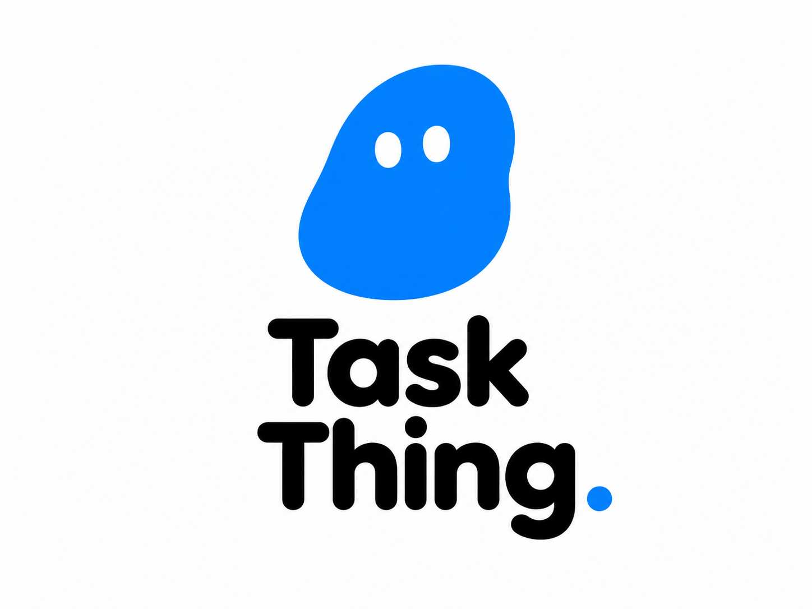

# Task Thing

<div align="center">
  
</div>

<div align="center">

**Get your things together.**

A lightweight desktop task widget and mobile companion with local-first
storage and direct Wi-Fi synchronization.

[Download latest release](https://github.com/Javanvibecodes/TaskThing/releases/latest) ·
[Documentation](docs/FEATURES.md) ·
[Report a bug](https://github.com/Javanvibecodes/TaskThing/issues)

</div>

[](https://github.com/Javanvibecodes/TaskThing/releases)


## What is Task Thing?

Task Thing keeps daily tasks, recurring tasks, and completed work close at
hand. The desktop app runs as a compact Electron widget. The mobile companion
runs through Capacitor. When you pair them, they synchronize directly over
your local network.

**Local-first by design:** core task data is stored on your devices. The
current project does not require a Task Thing account or hosted Task Thing
database. Update checks and issue reporting can connect to GitHub.

## Downloads

Get official builds from the
[GitHub Releases page](https://github.com/Javanvibecodes/TaskThing/releases).

| Platform | Download |
| --- | --- |
| Windows 10/11 (x64) | [Windows installer](https://github.com/Javanvibecodes/TaskThing/releases/latest/download/Task-Thing-win-x64.exe) |
| Android | [Android APK](https://github.com/Javanvibecodes/TaskThing/releases/latest/download/Task-Thing-android.apk) |

Only platforms with actual uploaded release assets are available for download.
The desktop installer is currently not code-signed, so Windows may show a
SmartScreen warning. Verify that the file came from the official release
before deciding whether to proceed.

## Core features

- Daily task creation, editing, prioritization, scheduling, and completion.
- Recurring tasks / habits.
- Tags and completed-task history.
- Compact desktop widget, system tray, and always-on-top option.
- Mobile companion with local persistence.
- Desktop-hosted, two-way local-network synchronization.
- Offline mobile change queue and reconnect support.
- Theme presets.

See [FEATURES.md](docs/FEATURES.md) for the current feature inventory.

## Pair your phone and PC

1. Connect the PC and phone to the same trusted Wi-Fi network or supported
   hotspot.
2. On the PC, open **Preferences** and find the local IP address and
   six-digit pairing code.
3. On Android, open Task Thing and select the **Sync** tab.
4. Enter the PC's local IP address and the displayed pairing code.
5. Tap **Connect** and wait for the connected status.

The pairing code is single-use and rotates after successful pairing. The
phone stores a reconnect token so you do not need to enter the code every
time. Use sync only on a trusted network: the current HTTP/WebSocket
connection is not encrypted.

For full steps, see [the user guide](docs/USER_GUIDE.md) and
[the sync protocol notes](docs/SYNC_PROTOCOL.md).

## Build from source

**Requirements:** Node.js 20+, pnpm 12+, and the SDKs for the platform you
want to build.

```bash
git clone https://github.com/Javanvibecodes/TaskThing.git
cd TaskThing
pnpm install
```

Desktop development:

```bash
pnpm desktop
```

Windows desktop package:

```bash
pnpm desktop:dist:win
```

Mobile build:

```bash
cd mobile
pnpm install
pnpm build
npx cap sync
npx cap open android
```

See [BUILD.md](docs/BUILD.md) for platform requirements, build targets, and
release checks.

## Documentation

| Document | Description |
| --- | --- |
| [Features](docs/FEATURES.md) | Current product capabilities |
| [Installation](docs/INSTALLATION.md) | Download and installation instructions |
| [User guide](docs/USER_GUIDE.md) | Tasks, habits, themes, and sync |
| [FAQ](docs/FAQ.md) | Common questions and troubleshooting |
| [Architecture](docs/ARCHITECTURE.md) | Application structure and data flow |
| [Sync protocol](docs/SYNC_PROTOCOL.md) | Local network protocol and message types |
| [Data storage](docs/DATA_STORAGE.md) | Local files, Web Storage, and backup notes |
| [Security](docs/SECURITY.md) | Threat model and hardening recommendations |
| [Roadmap](docs/ROADMAP.md) | Areas being evaluated; not delivery promises |
| [Build](docs/BUILD.md) | Development and build instructions |
| [Releases](docs/RELEASES.md) | Versioning and publishing checklist |
| [Changelog](CHANGELOG.md) | Version-by-version changes |

## Privacy

Task Thing's core task data is stored locally. Local sync is direct between
paired devices; it is not an encrypted transport or cloud backup. Some
support/update actions contact GitHub. Read [PRIVACY.md](PRIVACY.md) and
[SECURITY.md](SECURITY.md) before enabling synchronization.

## License

**Task Thing is proprietary software.** This repository is public for
viewing and inspection only. No general permission is granted to copy,
modify, redistribute, or create derivative works from the original project.
Official application binaries are subject to [EULA.md](EULA.md). Third-party
dependencies remain subject to their own licenses; see
[THIRD_PARTY_NOTICES.md](THIRD_PARTY_NOTICES.md).

## Support

Read [SUPPORT.md](SUPPORT.md) before opening an issue. Do not publish
security vulnerabilities, pairing codes, reconnect tokens, or private task
data in public issues.
